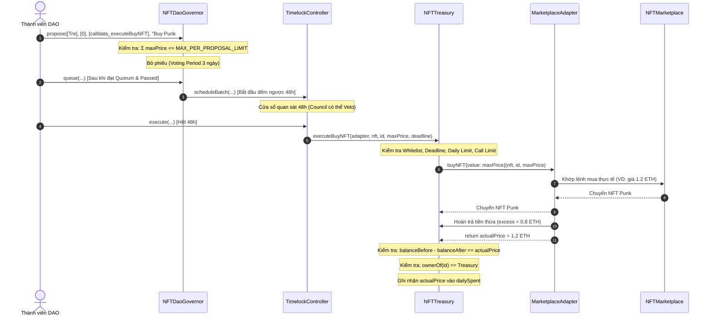

# KIẾN TRÚC HỆ THỐNG: SECURE COLLECTOR DAO

Tài liệu này mô tả tổng thể kiến trúc, mô hình phân tách trách nhiệm (Separation of Concerns), sơ đồ luồng dữ liệu và ranh giới tin cậy của toàn bộ hệ thống.

---

## 1. NGUYÊN TẮC PHÂN TÁCH TRÁCH NHIỆM (SEPARATION OF CONCERNS)

Để tránh sự chồng chéo quyền hạn và ngăn ngừa nghịch lý dữ liệu (như nghịch lý hash vòng lặp của proposalId), hệ thống phân tách thành 3 tầng độc lập:

```
┌────────────────────────────────────────────────────────────────────────┐
│                          TẦNG 1: QUYẾT ĐỊNH                            │
│                         (NFTDaoGovernor.sol)                           │
│  - Quyết định: CÁI GÌ ĐƯỢC PHÉP ĐỀ XUẤT VÀ BIỂU QUYẾT                 │
│  - Kiểm tra ngưỡng tạo đề xuất (proposalThreshold)                     │
│  - Quét calldata, kiểm tra trần chi tiêu toàn proposal:                │
│    Σ maxPrice <= MAX_PER_PROPOSAL_LIMIT                                │
│  - Kiểm phiếu, xác thực đạt Quorum và tỷ lệ đồng thuận                │
└────────────────────────────────────────────────────────────────────────┘
                                   │
                                   ▼ (Queue sau khi vote Passed)
┌────────────────────────────────────────────────────────────────────────┐
│                         TẦNG 2: THỜI GIAN TRỄ                          │
│                       (TimelockController.sol)                         │
│  - Quyết định: KHI NÀO MỚI ĐƯỢC THỰC THI                              │
│  - Lưu giữ lệnh trong cửa sổ quan sát 48h (Observation Window)         │
│  - Cho phép Security Council Veto/Cancel nếu phát hiện đề xuất xấu     │
│  - Chống thực thi lặp lại (Replay Protection)                          │
└────────────────────────────────────────────────────────────────────────┘
                                   │
                                   ▼ (onlyRole(TIMELOCK_ROLE))
┌────────────────────────────────────────────────────────────────────────┐
│                        TẦNG 3: BẢO VỆ TÀI SẢN                          │
│                          (NFTTreasury.sol)                             │
│  - Quyết định: THỰC THI NGHIỆP VỤ AN TOÀN VÀ LƯU TRỮ TÀI SẢN           │
│  - Hoàn toàn độc lập với logic bầu cử (Agnostic Vault)                 │
│  - Kiểm soát trần đơn lẻ: maxPrice <= MAX_PER_CALL_LIMIT               │
│  - Kiểm soát hạn ngạch ngày: Σ spent <= DAILY_SPENDING_LIMIT           │
│  - Kiểm tra Whitelist Adapter & Bộ sưu tập NFT                         │
│  - Kiểm tra thời hạn deadline & trạng thái pausedUntil                 │
│  - Xác thực quyền sở hữu NFT và đối chiếu chéo dòng tiền ròng          │
└────────────────────────────────────────────────────────────────────────┘
                                   │
                                   ▼ (Fixed Interface: buyNFT / sellNFT)
┌────────────────────────────────────────────────────────────────────────┐
│                     TẦNG 4: RANH GIỚI THỰC THI SÀN                     │
│                       (MarketplaceAdapter.sol)                         │
│  - Đóng vai trò: TRUSTED EXECUTION BOUNDARY                            │
│  - Kết nối với hợp đồng sàn giao dịch bên ngoài (Marketplace)          │
│  - Chịu trách nhiệm khớp lệnh mua/bán đúng giá                         │
│  - Bắt buộc hoàn trả tiền thừa: excess = msg.value - actualPrice       │
└────────────────────────────────────────────────────────────────────────┘
```

---

## 2. CÁC HỢP ĐỒNG CỐT LÕI (CORE CONTRACTS)

### 2.1. `GovToken.sol` (Token quản trị)
- **Chuẩn kế thừa**: `ERC20`, `ERC20Votes`, `ERC20Permit`.
- **Cơ chế thời gian**: Kế thừa chuẩn `ERC-6372`, override hàm `clock()` trả về `block.timestamp` và `CLOCK_MODE()` trả về `"mode=timestamp"`.
- **Đặc tính kinh tế**: Là token quyền biểu quyết thuần túy (Pure Governance). Việc tăng số dư Treasury không trực tiếp làm tăng giá trị hay quyền quy đổi tài sản tự động của token.

### 2.2. `NFTDaoGovernor.sol` (Hợp đồng Quản trị)
- **Chuẩn kế thừa**: OpenZeppelin Contracts v5 (`Governor`, `GovernorSettings`, `GovernorCountingSimple`, `GovernorVotes`, `GovernorVotesQuorumFraction`, `GovernorTimelockControl`).
- **Nhiệm vụ đặc thù**: Override hàm `propose(...)`:
  - Giải mã mảng `calldatas` tìm các hàm gọi đến `NFTTreasury.executeBuyNFT`.
  - Tính tổng các tham số `maxPrice`.
  - Từ chối tạo đề xuất ngay từ đầu nếu tổng chi phí vượt quá `MAX_PER_PROPOSAL_LIMIT`.

### 2.3. `TimelockController.sol` (OpenZeppelin Chuẩn)
- **Thời gian trễ**: 48 giờ (`minDelay = 2 days`).
- **Phân quyền vai trò**:
  - `PROPOSER_ROLE`: Chỉ cấp duy nhất cho hợp đồng `NFTDaoGovernor`.
  - `EXECUTOR_ROLE`: Cấp cho `address(0)` (cho phép cộng đồng thực thi khi đến hạn).
  - `CANCELLER_ROLE`: Cấp cho `NFTDaoGovernor` và `SecurityCouncil` (để hủy lệnh xấu).
  - `TIMELOCK_ADMIN_ROLE`: Được chuyển giao cho chính địa chỉ của Timelock sau khi deploy hoàn tất (khép kín quyền quản trị, loại bỏ EOA deployer).

### 2.4. `NFTTreasury.sol` (Kho bạc thông minh)
- **Chuẩn kế thừa**: `ERC721Holder`, `ReentrancyGuard`, `AccessControl`.
- **Lưu ký**: Giữ toàn bộ ETH của DAO và toàn bộ NFT (ERC-721).
- **Hàm nhận tiền**: `receive() external payable {}` rỗng, không chứa code để phục vụ việc nhận tiền hoàn trả an toàn từ Adapter.
- **Quyền hạn**: Chỉ chấp nhận lệnh gọi mua/bán từ địa chỉ có vai trò `TIMELOCK_ROLE`.

### 2.5. `INFTMarketplaceAdapter.sol` & `MarketplaceAdapter.sol`
- **Giao diện chuẩn hóa**:
  ```solidity
  interface INFTMarketplaceAdapter {
      function buyNFT(address nftContract, uint256 tokenId, uint256 maxPrice) external payable returns (uint256 actualPrice);
      function sellNFT(address nftContract, uint256 tokenId, uint256 minRevenue) external returns (uint256 netRevenue);
  }
  ```
- **Ranh giới tin cậy (Trusted Boundary)**: Adapter là hợp đồng trung gian bắt buộc phải được cộng đồng biểu quyết đưa vào Whitelist sau khi đã audit mã nguồn.

---

## 3. SƠ ĐỒ VÒNG ĐỜI MUA NFT (PURCHASE LIFECYCLE)



---

## 4. MA TRẬN PHÂN QUYỀN HỆ THỐNG (ACCESS CONTROL MATRIX)

| Vai trò (Role) | Người nắm giữ | Quyền được phép | Quyền bị nghiêm cấm |
| :--- | :--- | :--- | :--- |
| **Thành viên DAO** | Người giữ `GovToken` | Tạo đề xuất, bỏ phiếu biểu quyết | Không trực tiếp rút tiền hoặc can thiệp Treasury |
| **Governor** | `NFTDaoGovernor` | Kiểm phiếu, đưa lệnh vào Timelock | Không giữ tiền, không có quyền admin Timelock |
| **Timelock** | `TimelockController` | Người gọi duy nhất các hàm thực thi của Treasury | Không tự ý tạo lệnh nếu không qua Governor |
| **Security Council** | Multi-sig (3/5) | - Tạm dừng (`pauseTrading`) tối đa 7 ngày<br>- Hủy đề xuất xấu trong Timelock (`cancel`) | **Không có quyền rút tiền**<br>**Không được thay đổi Whitelist** |
| **Community Executor** | `address(0)` (Bất kỳ ai) | Gọi kích hoạt `execute` trên Timelock sau 48h | Không thể can thiệp vào payload giao dịch |
